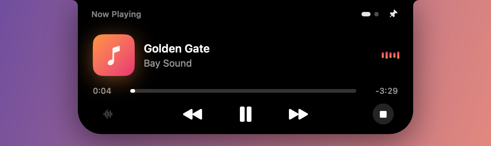
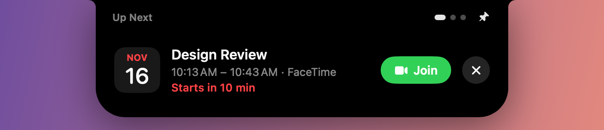
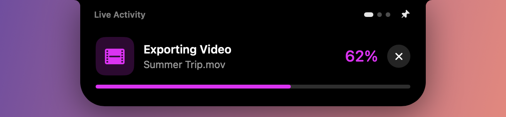
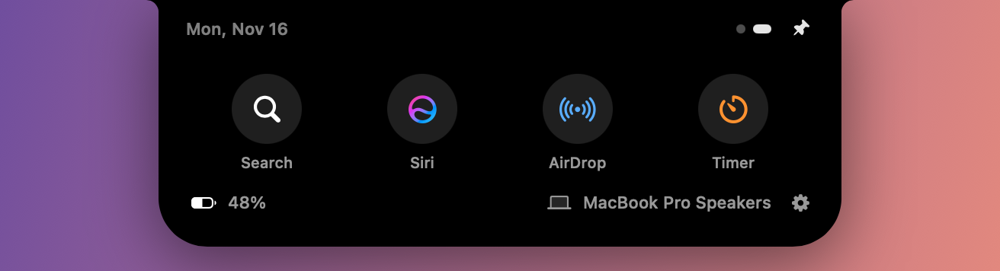
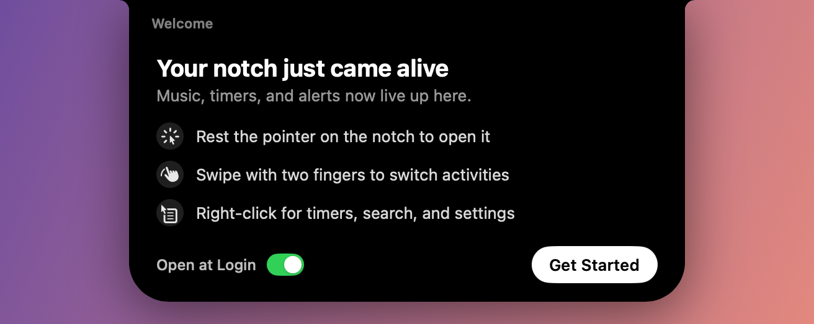

# NotchActivity

**A Dynamic Island–style home for music, timers, and live activities in your MacBook's notch.**

The notch turns into a black island that shows what's happening: the song that's playing in any app, a running timer, your next meeting, a build in progress. Rest the pointer on it and it opens into a card with full controls.



## Features

| | |
|---|---|
|  | **Now Playing from any app.** Music, Spotify, Podcasts, a YouTube tab in Safari or Chrome: whatever macOS is playing shows up with its cover art, a waveform tinted to match, and a scrubber you can drag. No setup and no permission prompts. |
|  | **Track previews.** When the song changes, the island widens for a moment to show the new title and artist. |
|  | **Timers, and more than one thing at once.** A second activity splits off into its own bubble. Click it to swap. |
|  | **Your next meeting.** Fifteen minutes before a calendar event, it appears with a countdown and a Join button for video calls. Off until you turn it on in Settings. |
|  | **System alerts.** Charging, low battery, AirPods and headphones connecting, Silent Mode, and unlocking your Mac. |
|  | **Live activities from your own scripts.** Anything that can run a command or open a URL can put a progress bar in the notch. See [Automate it](#automate-it). |
|  | **Quick actions.** App search with a built-in calculator, Siri, AirDrop (or just drag files to the notch), and timers. |

Hover to open, click to open instantly, swipe with two fingers to move between activities, right-click for everything else.

When an app goes full screen on the notched display, such as a video, a game, or a slideshow, the island disappears until you come back.

## Install

You need a MacBook with a notch, macOS 14 or later, and the Xcode Command Line Tools (`xcode-select --install`).

```bash
git clone https://github.com/BoatAngle/NotchActivity.git
cd NotchActivity
make install
```

That builds the app, copies it to `/Applications`, and launches it. A welcome card in the notch walks you through the rest, including opening at login.



Because you build it on your own Mac, there is no Gatekeeper warning to click through.

To add the `notch` command to your shell:

```bash
make cli
```

To remove everything:

```bash
make uninstall
```

## Automate it

NotchActivity listens for `notchactivity://` links, and ships a small command-line tool that wraps them. Use whichever fits.

### From a terminal

```bash
# Wrap any command: a spinner while it runs, then a check mark or a cross
notch run -- make build

# A one-off alert
notch alert "Deployed" "v2.1" --icon checkmark.seal.fill --tint green

# A live activity you update yourself
notch start render "Rendering" --subtitle "scene-04.blend" --icon cube.fill --progress 0
notch update render --progress 0.6
notch end render --ok "Rendered"

# Timers and playback
notch timer 25m
notch music next
```


Run `notch help` for the full list. `--icon` takes any [SF Symbol](https://developer.apple.com/sf-symbols/) name; `--tint` takes a color name or `#RRGGBB`.

### From Shortcuts, or any other app

Use the **Open URLs** action (or the equivalent in your tool of choice):

| URL | What it does |
|---|---|
| `notchactivity://activity?id=backup&title=Backing%20Up&icon=externaldrive.fill&progress=0.4` | Start or update an activity. Only the fields you pass change. |
| `notchactivity://activity?id=backup&progress=indeterminate` | Switch it to a spinner. |
| `notchactivity://end?id=backup&status=success&message=Done` | Finish it. `status` is `success` or `failure`; leave it out to remove it quietly. |
| `notchactivity://alert?title=Tea&value=Ready&icon=cup.and.saucer.fill&tint=orange` | Show an alert for a few seconds. |
| `notchactivity://timer?minutes=5` | Start a timer (`seconds=` also works; `action=cancel` stops it). |
| `notchactivity://music?action=toggle` | `toggle`, `next`, or `previous`. |
| `notchactivity://expand`, `collapse`, `search`, `settings` | Drive the island itself. |

Activities also accept `subtitle`, `tint`, `url` (an http or https link, shown as an Open button), and `duration` (seconds until it removes itself).

## Settings

Right-click the island or use the menu bar icon, then choose **Settings…**

- **General:** open at login, open on hover (turn it off to open on click only), hiding while an app is full screen, haptics.
- **Now Playing:** any app or built-in demo tracks, track previews, hiding a paused track after ten minutes, online artwork.
- **Calendar:** upcoming events. macOS asks for calendar access when you switch this on.
- **Alerts:** each kind can be turned off.

## Privacy

- No analytics, no accounts, nothing phones home.
- **Artwork lookups** are the only network requests. When a track has no local cover, the app asks Apple's public iTunes catalog for one, sending the track's store ID or its artist and title. Turn off **Find album artwork online** in Settings and it shows the playing app's icon instead.
- **Calendar** data is read on your Mac and never leaves it.
- The URL scheme only accepts display data. Links in activities are limited to http and https.

## How it works

The island is a borderless panel pinned to the physical notch and drawn in SwiftUI. It never takes keyboard focus (except while you type in search), and its transparent areas pass clicks through to whatever is underneath. The menu bar icon doubles as a spacer, so the island never sits on top of another app's icon.

Now Playing is the interesting part. macOS keeps a system-wide "now playing" record, but since macOS 15.4 only Apple-signed processes may read it. NotchActivity reads it through `/usr/bin/osascript`, which is one, and sends playback commands directly. That interface is private: if a future macOS update closes it, the app falls back to talking to Music and Spotify over Apple Events, which asks for Automation access once per app.

```
Sources/NotchActivity/
  Geometry.swift         notch location, layout constants, island shape
  Model.swift            presentation state machine, pages, timer
  NowPlaying.swift       system-wide Now Playing, commands, artwork, demo tracks
  SystemMonitors.swift   battery, audio output, mute, screen unlock
  FullScreen.swift       notices full-screen apps so the island can step aside
  CalendarMonitor.swift  next calendar event
  ExternalAPI.swift      the notchactivity:// URL scheme
  Search.swift           app search and calculator
  Views.swift            every presentation of the island
  Components.swift       artwork, waveform, scrubber, buttons
  SettingsView.swift     the Settings window
  Controller.swift       panel, hover, alerts, AirDrop, menus
Sources/notch/           the command-line tool
```

`make run` builds and launches from `./build` without installing. Logs: `log stream --info --predicate 'subsystem == "com.harrisonbraun.notchactivity"'`.

## Limitations

- It needs a display with a notch. With the lid closed on an external display, the island hides.
- macOS doesn't let third-party apps answer phone calls, read Focus status, or show other apps' Live Activities, so those aren't here.
- Builds are signed ad hoc by default. If you rebuild, macOS may ask again for Calendar or Automation access. Set `CODESIGN_IDENTITY` to your own certificate to avoid that: `CODESIGN_IDENTITY="Apple Development: …" make install`.
- Developed and tested on macOS 27 on a 16-inch MacBook Pro. It targets macOS 14 and later, but older versions haven't been tested.

## License

[MIT](LICENSE).

NotchActivity is an independent project and is not affiliated with Apple. Dynamic Island, MacBook, and macOS are trademarks of Apple Inc.
